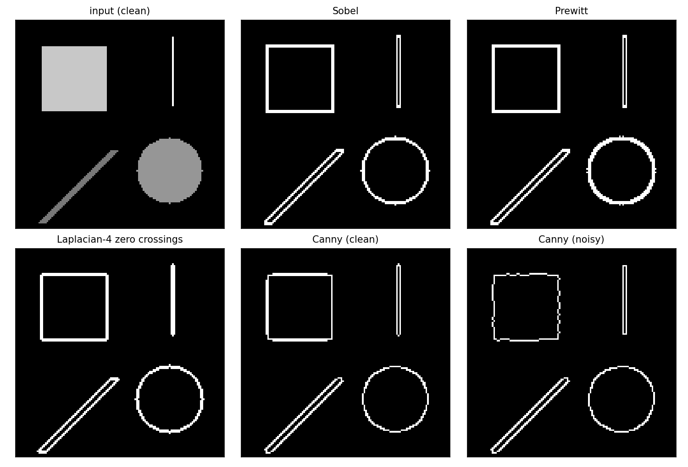

# Edge Detection Comparison

Four classical edge detectors **implemented from scratch** with
numpy — one shared convolution routine, no OpenCV / scikit-image
calls anywhere — and compared on a synthetic image whose edges are
known *exactly*, so the outputs can be measured instead of merely
looked at: **Sobel**, **Prewitt**, **Laplacian** zero crossings
(4- and 8-neighbour), and a complete simplified **Canny** pipeline
(Gaussian blur → Sobel gradients → non-maximum suppression →
double threshold → hysteresis).

## Background

An edge is a localised change of intensity. The methods here are
the three classical answers to "where are the changes, and which
of them count?" (full history and sources in
[docs/RESEARCH.md](docs/RESEARCH.md)):

* **First derivative (Sobel 1968, Prewitt 1970).** Convolve with a
  pair of 3×3 gradient kernels — a central difference crossed with
  a smoothing strip (`[1 2 1]` for Sobel, `[1 1 1]` for Prewitt) —
  and threshold the gradient magnitude. An ideal step of height
  `h` answers `4h` (Sobel) / `3h` (Prewitt) at the two boundary
  columns; the tests assert those exact numbers.
* **Second derivative (Laplacian).** The response changes sign
  across a step (+200 / −200 for the test step), so edges are the
  **zero crossings** — Marr & Hildreth's formulation — gated by a
  strength condition, because bare crossings are everywhere in
  noise. Second derivatives amplify high frequencies, which the
  noise experiment below makes impossible to miss.
* **Canny (1986).** Optimise explicitly for good detection, good
  localisation and a *single* response per edge: smooth first,
  take gradients, **thin** the magnitude ridge by non-maximum
  suppression, then accept weak pixels only when they connect to
  strong ones (**hysteresis**) — edges are contours, noise is not.

## Project structure

```text
edge-detection-comparison/
├── edges.py                    # entry point
├── requirements.txt            # numpy, Pillow, matplotlib
├── src/edge_detection/
│   ├── convolution.py          # correlate2d / convolve2d (the only filter)
│   ├── operators.py            # Sobel, Prewitt, Laplacian + zero crossings
│   ├── canny.py                # blur, NMS, double threshold, hysteresis
│   ├── testimage.py            # synthetic image + ground-truth geometry
│   └── cli.py                  # comparison run, metrics, PNG outputs
├── tests/
│   ├── test_convolution.py     # hand-computed kernel cases
│   ├── test_operators.py       # exact step responses (800 / 600 / ±200)
│   └── test_canny.py           # NMS ridge + hysteresis connectivity rules
├── examples/
│   ├── input.png               # the synthetic test image
│   ├── input_noisy.png         # + Gaussian noise, sigma = 10
│   ├── edges_sobel.png         # per-method edge maps (clean image)
│   ├── edges_prewitt.png
│   ├── edges_laplacian.png
│   ├── edges_canny.png
│   ├── comparison.png          # all panels in one figure
│   └── example_output.txt      # captured run
└── docs/RESEARCH.md            # sources, conventions, documented choices
```

## How to run

```bash
python3 edges.py --outdir examples
python3 tests/test_convolution.py
python3 tests/test_operators.py
python3 tests/test_canny.py
```

## Example output

The test image (128×128) holds a filled rectangle, a disk, a
45° band and a 1-pixel-wide line, none overlapping. Decision rules
are fixed and stated so the counts reproduce: Sobel / Prewitt
threshold at 0.25 × max magnitude; Laplacian crossings need a sign
change with |difference| ≥ 0.25 × max |response|; Canny thresholds
at 0.05 / 0.15 × post-NMS maximum after a σ = 1.0 Gaussian.

```text
method           clean  noisy (sigma=10)
sobel              840               848
prewitt            928               936
laplacian4         871              1227
laplacian8        1153              1335
canny              686               580

step-edge localisation (scan row 36, true boundary at column 15.5):
sobel   peak |Gx| at column 15   (error 0.5 px)
prewitt peak |Gx| at column 15   (error 0.5 px)
canny   edge columns [15, 16]    (error 0.5 px)
```

What the numbers say:

* **Localisation is a tie at the quantisation limit.** The true
  boundary lies *between* two pixels, so 0.5 px is the best any
  pixel-grid method can report; Sobel/Prewitt peak on both
  boundary columns (argmax returns the first), Canny marks both.
* **Prewitt marks ~10% more pixels than Sobel** under identical
  rules — arithmetic, not mystery: its peak step response is
  lower (3h vs 4h), so a threshold set at 0.25 × *its own* maximum
  is lower in absolute terms and admits more of the spread-out
  response around corners and the disk's staircase.
* **Noise barely moves the gradient methods' counts (+1%)** —
  on this high-contrast image the relative threshold sits far
  above the gradient noise (σ = 10 noise gives gradient noise of
  ~35 against a 255 threshold) — **but it detonates the
  Laplacian**: +41% crossings for the 4-neighbour variant. That
  is the second derivative doing exactly what the theory says
  it does to high-frequency noise.
* **Canny reports the fewest pixels, and fewer under noise
  (686 → 580).** NMS makes its clean map mostly 1 px wide where
  the others paint 2 px; under noise the blur plus hysteresis
  prune the weakest genuine segments (the rectangle's outline
  goes slightly wobbly in the figure) while rejecting isolated
  noise outright. Count is not quality — but the surviving
  pixels are nearly all on true contours.



## Design decisions

- **One filtering primitive.** Everything — gradient kernels,
  Laplacian, the separable Gaussian inside Canny — goes through
  `correlate2d`, whose semantics (kernel as written, zero/edge
  padding) are defined once and hand-tested. `convolve2d` is the
  same routine with a flipped kernel; the tests pin the
  difference with a shift kernel where the two visibly disagree.
- **Hand-computed tests, not snapshots.** The suite asserts the
  literal step responses (Sobel 800, Prewitt 600, Laplacian
  ±200 / ±600 on a step of 200), a ones-kernel convolution worked
  out entry by entry, NMS keeping a constructed ridge while
  suppressing its slopes, and the three hysteresis rules on a
  fixture where kept and dropped weak pixels have *identical*
  values and differ only in connectivity.
- **NMS keeps ties.** On a perfect step the ridge is two pixels
  wide with equal maxima; `>=` keeps both and lets the threshold
  stages decide, rather than arbitrarily erasing one side of
  every clean edge. Frame pixels are zeroed instead: their
  gradient-direction neighbours don't exist, so maximality is
  uncheckable there.
- **Thresholds are relative and printed.** Absolute thresholds
  would tie every number to this image's contrast; relative ones
  (fractions of each method's own maximum) make the comparison
  about the *methods*, and the CLI prints the absolute Canny
  thresholds it derived (low 25.9, high 77.6) for auditability.

## Limitations & future work

- The Laplacian is applied to the *unsmoothed* image; Marr &
  Hildreth's operator is the Laplacian *of a Gaussian*. The noise
  blow-up in the table is partly that omission, deliberately left
  visible — adding an LoG variant with a scale parameter is the
  obvious next column in the table.
- Canny here is the simplified pipeline: Sobel gradients instead
  of derivatives of Gaussians, thresholds as fractions of the
  maximum instead of estimated from the noise level, and no
  sub-pixel localisation (0.5 px is the grid's floor, not the
  algorithm's).
- One synthetic image, one noise level: enough to verify the
  implementations against ground truth, not a benchmark. A
  natural-image set with human-marked boundaries (e.g. BSDS)
  would be the step from *verification* to *evaluation*.
- Gradient-magnitude thresholding for Sobel/Prewitt is the
  textbook baseline, not a recommendation: the figure shows the
  thick, sometimes doubled responses that NMS exists to fix.
